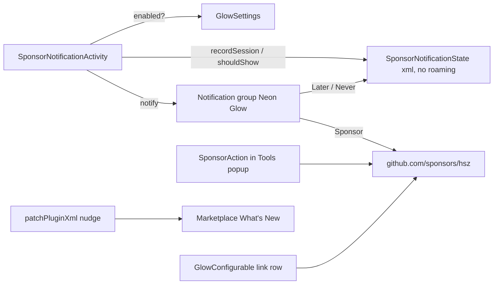

# Handoff

### Context for the next agent

The sponsorship-promotion strategy was designed and fully implemented in **Foldable Project View** (`/Users/hsz/Projects/intellij-foldable-project-view`, uncommitted working tree). The goal of the next session is to port the same strategy to **Neon Glow**, which lives at `/Users/hsz/Projects/ide-synthwave` (plugin id `info.chrzanowski.neonglow`, package `info.chrzanowski.neonglow`, bundle `messages.NeonGlowBundle`, repo `https://github.com/hsz/neon-glow`).

**Guiding principles (decided with the user, do not re-litigate):**
- The plugin stays **free**; no freemium, no licensing, no modal dialogs, no nag on install.
- **GitHub Sponsors is the primary channel** (`https://github.com/sponsors/hsz`); Ko-fi (`https://ko-fi.com/hszanowski`) and PayPal (`https://paypal.me/hsz`) are secondary one-time fallbacks, listed in that order wherever there is room.
- Ask once, at a *value moment*, with `Remind me later` and `Don't show again`.
- Reuse the IntelliJ Platform Gradle Plugin 2.19.0 changelog conventions; do not re-implement change-notes rendering.

### Reference implementation (copy from Foldable Project View)
Do not duplicate the code here — read these files in the FPV repo and port them:

| Strategy item | FPV source of truth |
|---|---|
| 1. Value-moment notification | `src/main/kotlin/ski/chrzanow/foldableprojectview/sponsor/SponsorNotificationState.kt`, `.../sponsor/SponsorNotificationActivity.kt`, `src/test/kotlin/.../sponsor/SponsorNotificationStateTest.kt`, `plugin.xml` (`<notificationGroup id="Foldable Project View" displayType="STICKY_BALLOON">` + `<postStartupActivity>`), `FoldableProjectViewConstants.kt` (`SPONSOR_*_URL`, `SPONSOR_MIN_SESSIONS = 10`, `SPONSOR_MIN_USAGE = 14.days`, `SPONSOR_SNOOZE = 90.days`), bundle keys `foldableProjectView.sponsor.notification.*` |
| 2. Marketplace description | `plugin.xml` `<description>` closing paragraph *"Free and sponsor-supported."* + `img.shields.io/github/sponsors/hsz` badge |
| 3. Settings link row | `FoldableProjectViewConfigurable.kt` — `row(message("...settings.support")) { browserLink(...) x3 }.bottomGap(BottomGap.SMALL)` above the enable checkbox; bundle keys `foldableProjectView.settings.support*` |
| 4. Menu action | `actionSystem/SponsorAction.kt` (`DumbAware`, `ActionUpdateThread.BGT`, `BrowserUtil.browse(SPONSOR_GITHUB_URL)`), `plugin.xml` group `ProjectView.FoldableProjectView.Sponsor` (separator + action, `anchor="last"`) |
| 5. What's New nudge | `build.gradle.kts` — `tasks { patchPluginXml { changeNotes = intellijPlatform.pluginConfiguration.changeNotes.map { nudge + it } } }` |

### Neon Glow – current state (inspected)
- `.github/FUNDING.yml` — identical to FPV; nothing to do.
- `README.md` lines 5–7 — same "Support Neon Glow" blockquote at the top (left untouched in FPV too; optional).
- `plugin.xml` `<description>` — **no sponsor mention at all**; ends with the SynthWave '84 attribution paragraph.
- `settings/GlowConfigurable.kt` lines 56–61 — a full `group(settings.support.title)` with `AllIcons.General.Information` + HTML `text(settings.support.comment)` is already the **first** element of the panel; it is visible but heavy (3 lines + "other projects" link). Bundle keys: `settings.support.title`, `settings.support.comment` in `src/main/resources/messages/NeonGlowBundle.properties` lines 54–55.
- `settings/GlowSettings.kt` — `@Service(APP)` `PersistentStateComponent` with `state.enabled`; `GlowSettings.getInstance()`.
- `ui/GlowStartupActivity.kt` — existing `ProjectActivity` registered as `<postStartupActivity>`.
- `plugin.xml` `<actions>` — `ToggleGlowAction` plus popup group `info.chrzanowski.neonglow.Tools` (Open Settings / Clear Caches / Copy Diagnostics) under `UIToggleActions` (`View | Appearance`). There is no Project View integration; this popup is the gear-menu equivalent.
- `build.gradle.kts` — IPGP 2.19.0 + `org.jetbrains.changelog` 2.5.0 via `settings.gradle.kts`; `pluginRepositoryUrl` set in `gradle.properties`; no `changeNotes` override and no `<change-notes>` in `plugin.xml` → conventions are active, same as FPV.
- No `notificationGroup` registered yet. No `Constants` object exists; URLs are currently inline in the bundle HTML.
- Tests use `BasePlatformTestCase` (JUnit 4) under `src/test/kotlin/info/chrzanowski/neonglow/...`.
- `CHANGELOG.md` follows Keep a Changelog with an `[Unreleased]` section.

### Suggested skills for the next session
- `implement` — execute the delivery stages below against `/Users/hsz/Projects/ide-synthwave`.
- `handoff` — if the session is interrupted, produce the next handoff document.

### Sensitive data
None; all URLs are public sponsorship links.

# Technical Design

### Key Decisions
- **Value moment for Neon Glow** = "project session opened while glow is enabled" (`GlowSettings.getInstance().state.enabled`), mirroring FPV's "session with folding enabled". Thresholds stay 10 sessions / 14 days / 90-day snooze; a visual plugin delivers value every session, so no stricter trigger is needed.
- **Keep a separate `SponsorNotificationActivity`** rather than folding it into `GlowStartupActivity`: keeps the sponsor package self-contained and copy-pasteable between plugins.
- **Introduce `NeonGlowConstants`** (`info.chrzanowski.neonglow.NeonGlowConstants`) holding `SPONSOR_GITHUB_URL`, `SPONSOR_KOFI_URL`, `SPONSOR_PAYPAL_URL`, `SPONSOR_MIN_SESSIONS`, `SPONSOR_MIN_USAGE`, `SPONSOR_SNOOZE` so URLs stop living in bundle HTML.
- **Menu placement**: `View | Appearance | Neon Glow Tools` popup (`info.chrzanowski.neonglow.Tools`) gets a separator + `♥ Sponsor Neon Glow` as the last entry — the analogue of FPV's Project View gear menu.
- **Notification actions**: GitHub Sponsors, Ko-fi, PayPal, Remind me later, Don't show again (same as the current FPV state). If the user later chooses to slim FPV to a single donation action, apply the same to Neon Glow.

### Proposed Changes

**1. Notification (new package `info.chrzanowski.neonglow.sponsor`)**
- `SponsorNotificationState.kt` — port of FPV class: `@Service(APP)`, `@State(name = "NeonGlowSponsor", storages = [Storage("NeonGlowSponsor.xml", roamingType = RoamingType.DISABLED)])`, `State : BaseState` with `firstUse`, `sessions`, `snoozedUntil`, `dismissed`; `recordSession(now)`, `shouldShow(now)`, `snooze(now)`, `dismiss()`.
- `SponsorNotificationActivity.kt : ProjectActivity` — skip on `isUnitTestMode || isHeadlessEnvironment || project.isDefault`; return if `!GlowSettings.getInstance().state.enabled`; `recordSession()`; if `shouldShow()` → `NotificationGroupManager.getInstance().getNotificationGroup("Neon Glow").createNotification(title, content, INFORMATION)` with the five `NotificationAction.createSimpleExpiring` actions, `whenExpired { if not dismissed → snooze }`, `notify(project)`; call `snooze()` right after showing so it is not re-shown on the next project.
- `plugin.xml`: `<notificationGroup id="Neon Glow" displayType="STICKY_BALLOON" key="notification.group.neonGlow"/>` and `<postStartupActivity implementation="info.chrzanowski.neonglow.sponsor.SponsorNotificationActivity"/>`.
- `NeonGlowBundle.properties`: `sponsor.notification.title/content/github/kofi/paypal/later/never`, `notification.group.neonGlow=Neon Glow`.

**2. Marketplace description (`plugin.xml`)**
- Append after the attribution paragraph: `<br><br><b>Free and sponsor-supported.</b> If Neon Glow brightens your day, consider <a href="https://github.com/sponsors/hsz">sponsoring it on GitHub</a> (one-time tips via <a href="https://ko-fi.com/hszanowski">Ko-fi</a> or <a href="https://paypal.me/hsz">PayPal</a> are welcome too).<br><a href="https://github.com/sponsors/hsz"></a>`.
- Description already opens with the pitch, so no reordering needed.

**3. Settings (`GlowConfigurable.kt`)**
- Replace the `group(settings.support.title) { row { icon(...); text(...) } }` block (lines 56–61) with `row(message("settings.support")) { browserLink("♥ Sponsor on GitHub", SPONSOR_GITHUB_URL); browserLink("Ko-fi", SPONSOR_KOFI_URL); browserLink("PayPal", SPONSOR_PAYPAL_URL) }.bottomGap(BottomGap.SMALL)`.
- Bundle: replace `settings.support.title` / `settings.support.comment` with `settings.support=Enjoying Neon Glow? It's free and sponsor-supported:`, `settings.support.github`, `settings.support.kofi`, `settings.support.paypal`. Check `GlowConfigurableTest` for references to the removed keys/components.

**4. Menu action (`actions/SponsorAction.kt`)**
- Copy FPV `SponsorAction` verbatim (package/import changes only).
- `plugin.xml`: inside `<group id="info.chrzanowski.neonglow.Tools">` add `<separator/>` + `<action id="info.chrzanowski.neonglow.SponsorAction" class="info.chrzanowski.neonglow.actions.SponsorAction"/>` as the last entries.
- Bundle: `action.info.chrzanowski.neonglow.SponsorAction.text=\u2665 Sponsor Neon Glow`, `.description=Neon Glow is free and sponsor-supported; opens its GitHub Sponsors page`.

**5. What's New nudge (`build.gradle.kts`)**
- Add to the existing `tasks { }` block:
```kotlin
patchPluginXml {
    val nudge = markdownToHTML(
        "_Neon Glow is free and sponsor-supported. If it brightens your day, consider " +
            "[♥ sponsoring it on GitHub](https://github.com/sponsors/hsz)._"
    )
    changeNotes = intellijPlatform.pluginConfiguration.changeNotes.map { nudge + it }
}
```
  with `import org.jetbrains.changelog.markdownToHTML`.

**6. `CHANGELOG.md`** — `Added` entries under `[Unreleased]` for items 1, 3, 4, 5 (same wording style as FPV).

### File Structure (Neon Glow repo)
- **Added** `src/main/kotlin/info/chrzanowski/neonglow/NeonGlowConstants.kt`
- **Added** `src/main/kotlin/info/chrzanowski/neonglow/sponsor/SponsorNotificationState.kt`
- **Added** `src/main/kotlin/info/chrzanowski/neonglow/sponsor/SponsorNotificationActivity.kt`
- **Added** `src/main/kotlin/info/chrzanowski/neonglow/actions/SponsorAction.kt`
- **Added** `src/test/kotlin/info/chrzanowski/neonglow/sponsor/SponsorNotificationStateTest.kt`
- **Modified** `src/main/resources/META-INF/plugin.xml`, `src/main/resources/messages/NeonGlowBundle.properties`, `src/main/kotlin/info/chrzanowski/neonglow/settings/GlowConfigurable.kt`, `build.gradle.kts`, `CHANGELOG.md`

### Architecture Diagram


### Risks
- Neon Glow is app-level and `ProjectActivity` runs per opened project: the `snooze()`-after-show guard (as in FPV) prevents a balloon per project window.
- `GlowConfigurableTest` may assert on the old support group — update accordingly.
- Any pre-existing `verifyPlugin` problems in Neon Glow are unrelated; only confirm no new ones from the sponsor code.

# Testing

### Validation Approach
Mirror the FPV verification: unit-test the pure state logic, compile/verify the rest.

### Key Scenarios
- `SponsorNotificationStateTest` (port of FPV's 8 tests, `BasePlatformTestCase` or plain JUnit 4): not shown before 10 sessions; not shown before 14 days; shown when both met; snooze hides until deadline and shows after; dismiss hides forever; `firstUse` retained across `loadState`; XML round-trip of `State`.
- `./gradlew test` — whole suite (incl. `GlowConfigurableTest`) green.
- `./gradlew patchPluginXml` — `build/tmp/patchPluginXml/plugin.xml` has `<change-notes>` starting with the nudge, followed by the rendered `[Unreleased]`/current-version section; `<description>` ends with the sponsor paragraph and badge.
- `./gradlew verifyPluginStructure verifyPlugin` — no new problems introduced by the sponsor package, action or notification group.

### Edge Cases
- Glow disabled → no session recorded, no notification.
- Unit-test / headless mode → activity returns early (so existing tests never see a balloon).
- Balloon closed via the X → treated as `Remind me later`.

# Delivery Steps

### ✓ Step 1: Add sponsor constants and value-moment notification to Neon Glow
Neon Glow shows a one-time sponsorship notification after 10 sessions over 14 days with glow enabled, with Later/Never options.

- Create `NeonGlowConstants.kt` with `SPONSOR_GITHUB_URL`, `SPONSOR_KOFI_URL`, `SPONSOR_PAYPAL_URL`, `SPONSOR_MIN_SESSIONS = 10`, `SPONSOR_MIN_USAGE = 14.days`, `SPONSOR_SNOOZE = 90.days`.
- Port `SponsorNotificationState.kt` from FPV into `info.chrzanowski.neonglow.sponsor` (`@Service(APP)`, `Storage("NeonGlowSponsor.xml", roamingType = DISABLED)`).
- Port `SponsorNotificationActivity.kt`; gate on `GlowSettings.getInstance().state.enabled` instead of FPV's per-project `foldingEnabled`; keep the headless/unit-test/default-project guards and snooze-after-show.
- Register `<notificationGroup id="Neon Glow" displayType="STICKY_BALLOON" key="notification.group.neonGlow"/>` and the `<postStartupActivity>` in `plugin.xml`.
- Add `sponsor.notification.*` and `notification.group.neonGlow` keys to `NeonGlowBundle.properties`.
- Port `SponsorNotificationStateTest` and run `./gradlew test --tests '*SponsorNotificationStateTest'`.

### ✓ Step 2: Update Marketplace description and settings support row
The Marketplace page ends with a short GitHub-Sponsors-first paragraph and badge, and the settings page shows a compact clickable link row instead of the heavy support group.

- Append the `Free and sponsor-supported.` paragraph + `img.shields.io/github/sponsors/hsz` badge to the end of `<description>` in `plugin.xml`.
- In `GlowConfigurable.kt`, replace the `group(settings.support.title)` block with `row(message("settings.support")) { browserLink x3 }.bottomGap(BottomGap.SMALL)` using the new constants (GitHub first, then Ko-fi, PayPal).
- Replace `settings.support.title`/`settings.support.comment` with `settings.support`, `settings.support.github`, `settings.support.kofi`, `settings.support.paypal` in the bundle.
- Fix `GlowConfigurableTest` if it references the removed group; run `./gradlew test`.

### ✓ Step 3: Add Sponsor action to the Neon Glow Tools menu
`View | Appearance | Neon Glow Tools` ends with a separated `♥ Sponsor Neon Glow` entry opening GitHub Sponsors.

- Add `actions/SponsorAction.kt` (copy of FPV's `SponsorAction`, `DumbAware`, `ActionUpdateThread.BGT`).
- Add `<separator/>` + `<action id="info.chrzanowski.neonglow.SponsorAction" .../>` as the last items of group `info.chrzanowski.neonglow.Tools` in `plugin.xml`.
- Add `action.info.chrzanowski.neonglow.SponsorAction.text/description` to the bundle.
- Run `./gradlew verifyPluginStructure`.

### ✓ Step 4: Prepend sponsorship nudge to Marketplace What's New and update changelog
Every Marketplace release note opens with the one-line sponsor nudge rendered on top of the convention-generated changelog section.

- In `build.gradle.kts` `tasks { }` add `patchPluginXml { changeNotes = intellijPlatform.pluginConfiguration.changeNotes.map { nudge + it } }` with `markdownToHTML` nudge text adapted to Neon Glow; do not add `changelog { }` or `pluginConfiguration.changeNotes` overrides (IPGP 2.19.0 conventions already handle them).
- Add `Added` entries under `[Unreleased]` in `CHANGELOG.md` for the notification, settings row, menu action and What's New nudge.
- Run `./gradlew patchPluginXml` and inspect `build/tmp/patchPluginXml/plugin.xml` for `<change-notes>` and the updated `<description>`; run `./gradlew verifyPlugin` to confirm no new problems.