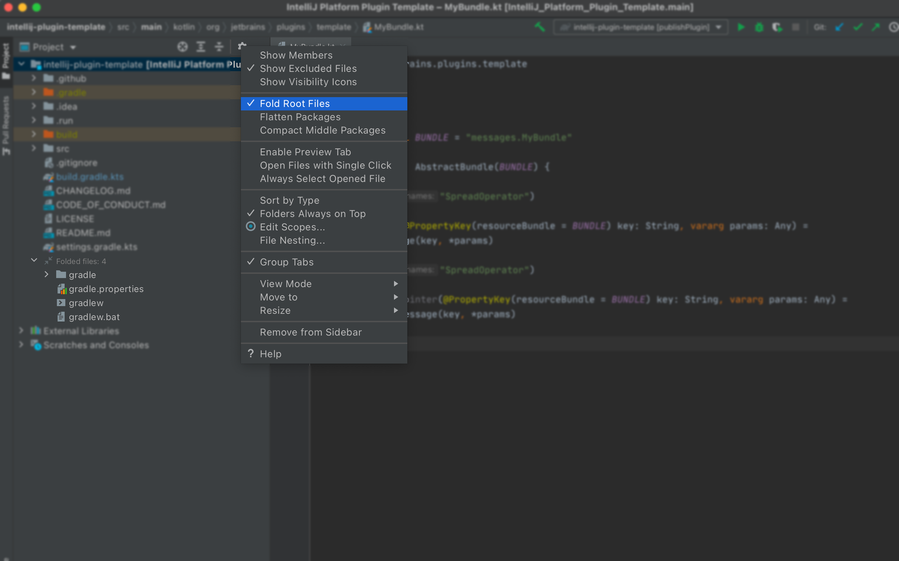
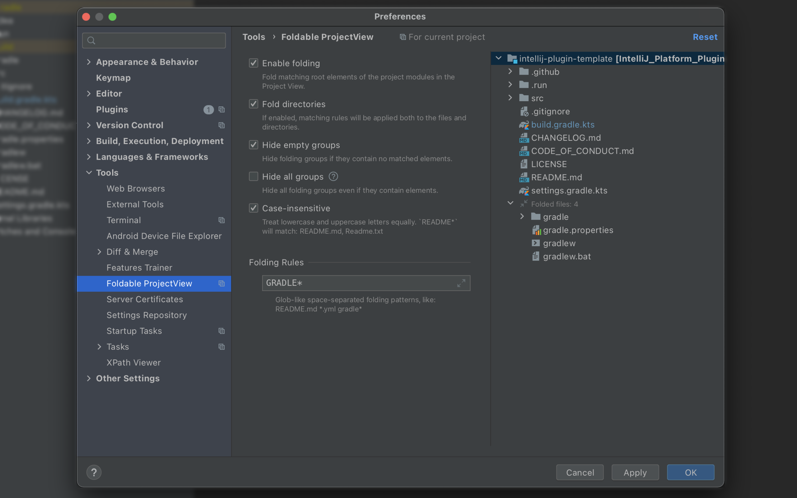

# Foldable Project View


[](https://plugins.jetbrains.com/plugin/17288)
[](https://plugins.jetbrains.com/plugin/17288)

<!-- Plugin description -->

> **Support Foldable Project View**
>
> If you find this plugin useful, support its development via **[GitHub Sponsors](https://github.com/sponsors/hsz)**, **[Ko-fi](https://ko-fi.com/hszanowski)**, or **[PayPal](https://paypal.me/hsz)**.
>
> You can also find my other projects on [GitHub](https://github.com/hsz).

The Foldable Project View is a plugin for the IntelliJ-based IDEs that lets you fold files located in the root of your project.

Available features:
- Fold matching root elements of the project modules in the Project View
- Multiple named folding rules with custom foreground/background colors
- Enable/disable folding via Preferences or Project View options menu
- Optionally fold directories
- Optionally fold in nested directories
- Built-in `Ignored files` rule folding the VCS-ignored files – rename, color, reorder, hide, or disable it like any other rule
- Enable or disable rules without removing them
- Hide empty groups
- Hide matched elements instead of grouping them, per rule
- Case-insensitive matching
- Gitignore-like patterns with negation (`!pattern`), directory-only matching (`dir/`), and quoted names with spaces
- Rules reading their patterns from ignore-like files in the repository, like `.foldignore` or `.dockerignore`
- Search scopes based on the folding rules
- Live Project View preview
- Defaults for new projects, synchronized by Settings Sync

## Demo


<!-- Plugin description end -->

## Screenshots

### Project View


### Preferences


## Usage

Open <kbd>Settings/Preferences</kbd> > <kbd>Tools</kbd> > <kbd>Foldable Project View</kbd> and define the folding rules.
Each rule has a name, which is used as the group label in the Project View, and a list of space-separated
gitignore-like glob patterns in the <kbd>Patterns</kbd> field, e.g.:

```
README.md *.yml !docker-compose.yml gradle* .github/ "My Notes.md"
```

Patterns are matched against paths relative to the module content root:

- `*` matches any characters except `/`, `?` matches a single character, `**` matches any number of directories,
  `[abc]`/`[a-z]`/`[!abc]` are character classes, and `\` escapes the next character,
- patterns without a slash match on any level, a leading slash anchors the pattern to the root (`/README.md`),
- a trailing slash matches directories only (`build/`), if <kbd>Also fold directories</kbd> is enabled,
- a leading `!` negates the pattern: `*.yml !docker-compose.yml` matches all YAML files except `docker-compose.yml`;
  as in gitignore, the last matching pattern decides,
- names containing spaces are wrapped in double quotes (`"My Notes.md"`) or have the spaces escaped (`My\ Notes.md`).

Invalid patterns (e.g., `[z-a]`) are skipped; the settings page reports them with a warning next to the pattern field
and in the rules table. Rules are applied in order – the first matching rule takes precedence. Folding rules are also
available as search scopes (e.g., in <kbd>Find in Files</kbd>).

Each rule either groups the matched elements into a folding group (the default) or hides them from the Project View
entirely – pick the action in the rule editor. Hidden elements can still be found with <kbd>Search Everywhere</kbd>
or the rule's search scope. Rules can be disabled with the checkbox in the first column of the table – disabled rules
are kept, but neither applied nor exposed as search scopes.

The built-in `Ignored files` rule folds the files and folders ignored by the VCS. It cannot be removed, but it can be
disabled (also with the <kbd>Fold Ignored Files</kbd> toggle in the Project View options menu), renamed, colored, moved
to change its precedence, or switched to the `Hide` action.

By default, folding is applied to the module roots only. Enable <kbd>Fold in nested directories</kbd> to apply the rules
to the content of all directories – anchored patterns like `/README.md` still match root elements only, and VCS-ignored
files are folded in the module roots only.

Folding works in the <kbd>Project</kbd> pane as well as in the scope-based panes (<kbd>Project Files</kbd>, custom scopes).
The scope-based panes pass only files to the plugin, so directories are not folded there, even with <kbd>Also fold directories</kbd> enabled.

### Patterns from ignore-like files

Instead of entering the patterns in the IDE, a rule can read them from files kept in the repository: switch the rule's
<kbd>Source</kbd> to <kbd>File</kbd> and list the space-separated paths of the files, relative to the module content root,
e.g. `.foldignore` or `.foldignore .dockerignore`. Every line of such a file is a single gitignore-like pattern with the
syntax described above (spaces are a part of the pattern), blank lines and lines starting with `#` are skipped:

```gitignore
# Documentation
*.md
!CHANGELOG.md
LICENSE*
```

The files are looked up in the content root of every module, so each module can have its own `.foldignore`. The Project
View is refreshed whenever the files change, and the settings page warns about files that do not exist in any module root.
This is the way to go when the folding rules should be versioned together with the project while `.idea/FoldableProjectView.xml` is not.

### Defaults for new projects

Settings are stored per project in `.idea/FoldableProjectView.xml`. Projects without stored settings start with the
defaults, which are kept at the IDE level and synchronized by Settings Sync. The defaults change only when you ask for it:

- <kbd>Use as Defaults for New Projects</kbd> in the project settings stores the current settings as the defaults,
- <kbd>Copy from Defaults</kbd> replaces the settings of the current project with the defaults,
- the same page under the settings for new projects (<kbd>File</kbd> > <kbd>New Projects Setup</kbd> >
  <kbd>Settings for New Projects…</kbd>) edits the defaults directly.

## Development

```bash
./gradlew buildPlugin   # build the plugin distribution into build/distributions
./gradlew test          # run tests
./gradlew runIde        # run a sandboxed IDE with the plugin installed
./gradlew verifyPlugin  # run the IntelliJ Plugin Verifier
```

## Installation

- Using IDE built-in plugin system:
  
  <kbd>Settings/Preferences</kbd> > <kbd>Plugins</kbd> > <kbd>Marketplace</kbd> > <kbd>Search for "Foldable Project View"</kbd> >
  <kbd>Install Plugin</kbd>
  
- Manually:

  Download the [latest release](https://github.com/hsz/intellij-foldable-projectview/releases/latest) and install it manually using
  <kbd>Settings/Preferences</kbd> > <kbd>Plugins</kbd> > <kbd>⚙️</kbd> > <kbd>Install plugin from disk...</kbd>


---
Plugin based on the [IntelliJ Platform Plugin Template][template].

[template]: https://github.com/JetBrains/intellij-platform-plugin-template
