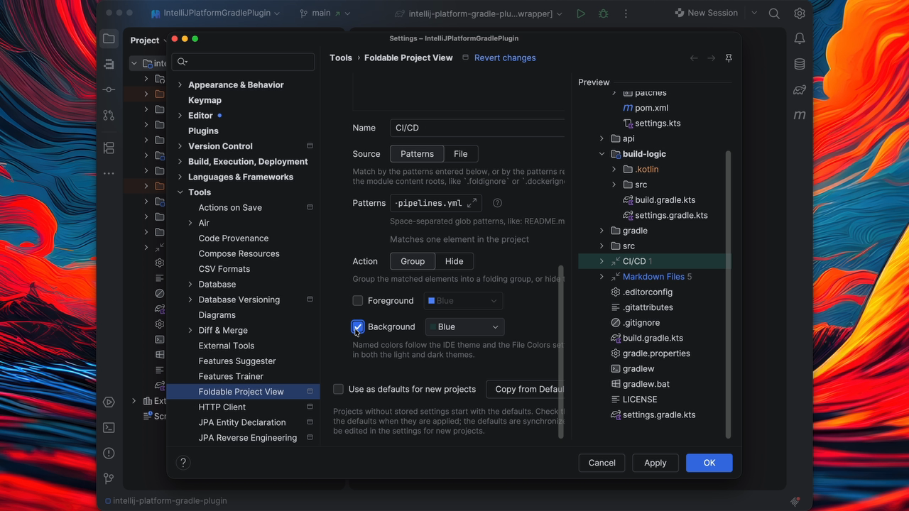

# Foldable Project View


[](https://plugins.jetbrains.com/plugin/17288)
[](https://plugins.jetbrains.com/plugin/17288)
[](https://github.com/sponsors/hsz)

<!-- Plugin description -->
Foldable Project View declutters the Project View of the IntelliJ-based IDEs: files and directories matching your
rules – READMEs, CI configs, build scripts, dotfiles, VCS-ignored files – are folded into named, colored groups or
hidden altogether, so the code you work on is the first thing you see.

Available features:
- Multiple named folding rules with gitignore-like patterns, applied to the module roots or to all nested directories
- Group the matched elements or hide them from the Project View, per rule
- Theme-aware palette of group colors (Blue, Green, Orange, Rose, Violet, Yellow, Gray) or custom colors
- Built-in `Ignored files` rule folding the VCS-ignored files – rename, color, reorder, hide, or disable it like any other rule
- Negation (`!pattern`), directory-only matching (`dir/`), quoted names with spaces, and case-insensitive matching
- Rules reading their patterns from ignore-like files in the repository, like `.foldignore` or `.dockerignore`
- Rule presets (Documentation, CI/CD, Build, Configuration, Dotfiles) and a live count of the elements matched by the edited rule
- Enable or disable rules without removing them, optionally fold directories, hide empty groups
- Enable/disable folding via Settings or the Project View options menu
- Search scopes based on the folding rules, e.g., in `Find in Files`
- Live Project View preview in the settings
- Defaults for new projects, synchronized by Settings Sync

Works in all IntelliJ-based IDEs (IntelliJ IDEA, PyCharm, WebStorm, Rider, GoLand, …) on IntelliJ Platform 2025.3+.
See the [documentation](https://github.com/hsz/intellij-foldable-project-view#usage) for the details.

<a href="https://github.com/hsz/intellij-foldable-project-view/raw/main/.github/readme/Foldable.mp4"></a>

> **Free and sponsor-supported.** If the plugin saves you time, consider sponsoring it via
> **[GitHub Sponsors](https://github.com/sponsors/hsz)**, **[Ko-fi](https://ko-fi.com/hszanowski)**, or **[PayPal](https://paypal.me/hsz)**.
> You can also find my other projects on [GitHub](https://github.com/hsz).
<!-- Plugin description end -->

## Demo

[](https://github.com/user-attachments/assets/409d979f-8fa2-4d46-8729-78a6e9895b6d)

## Compatibility

- IntelliJ Platform 2025.3 and newer
- All IntelliJ-based IDEs: IntelliJ IDEA, PyCharm, WebStorm, PhpStorm, Rider, GoLand, CLion, RubyMine, DataGrip, Android Studio, …

## Usage

Open <kbd>Settings</kbd> > <kbd>Tools</kbd> > <kbd>Foldable Project View</kbd> and define the folding rules.
Each rule has a name, which is used as the group label in the Project View, and a list of space-separated
gitignore-like glob patterns in the <kbd>Patterns</kbd> field, e.g.:

```
README.md *.yml !docker-compose.yml gradle* .github/ "My Notes.md"
```

The <kbd>Preview</kbd> next to the settings is a live, read-only Project View reflecting the unsaved settings: selecting
a rule in the table highlights its folding group in the preview, and selecting a group in the preview selects its rule.
Folding as a whole is switched with <kbd>Enable folding</kbd> on the settings page or <kbd>Enable Folding</kbd> in the
Project View options menu (<kbd>⋮</kbd> in the Project tool window header).

### Rules and patterns

Patterns are matched against paths relative to the module content root:

- `*` matches any characters except `/`, `?` matches a single character, `**` matches any number of directories,
  `[abc]`/`[a-z]`/`[!abc]` are character classes, and `\` escapes the next character,
- patterns without a slash match on any level, patterns containing a slash are anchored to the root (`/README.md`, `src/*.md`),
- a trailing slash matches directories only (`build/`), if <kbd>Also fold directories</kbd> is enabled,
- a leading `!` negates the pattern: `*.yml !docker-compose.yml` matches all YAML files except `docker-compose.yml`;
  as in gitignore, the last matching pattern decides,
- names containing spaces are wrapped in double quotes (`"My Notes.md"`) or have the spaces escaped (`My\ Notes.md`),
- matching is case-insensitive unless <kbd>Case-sensitive</kbd> is enabled.

The <kbd>+</kbd> button of the rules table adds an empty rule or one of the presets (Documentation, CI/CD, Build,
Configuration, Dotfiles) that can be adjusted afterwards. While editing, the rule editor shows how many elements of the
project the rule matches with the current options – hover the counter to see the first matched paths – and the <kbd>?</kbd>
icon next to the <kbd>Patterns</kbd> field recaps the pattern syntax.

Rules are applied in order – the first matching rule takes precedence. Rules with no name are labeled `Unnamed rule`,
rules with no patterns are kept but not applied, and both are reported with a warning. Invalid patterns (e.g., `[z-a]`)
are skipped; the settings page reports them with a warning next to the pattern field and in the rules table.

### Group or hide

Each rule either groups the matched elements into a folding group (the default) or hides them from the Project View
entirely – pick the <kbd>Action</kbd> in the rule editor. Hidden elements can still be found with <kbd>Search Everywhere</kbd>
or the rule's search scope.

Rules can be disabled with the checkbox in the first column of the table – disabled rules are kept, but neither applied
nor exposed as search scopes. By default, a module root shows the group of every rule, even an empty one, so the rules
are visible at a glance; <kbd>Hide empty groups</kbd> removes the groups whose rules match nothing (nested directories
never show empty groups).

Folding rules are also available as search scopes (e.g., in <kbd>Find in Files</kbd>), named after the rules.

### Ignored files

The built-in `Ignored files` rule folds the files and folders ignored by the VCS. It cannot be removed, but it can be
disabled (also with the <kbd>Fold Ignored Files</kbd> toggle in the Project View options menu), renamed, colored, moved
to change its precedence, or switched to the `Hide` action.

### Colors

The foreground and background of a folding group are picked from a palette of named colors (Blue, Green, Orange, Rose,
Violet, Yellow, Gray) that follow the IDE theme – the backgrounds are the platform File Colors, so the groups look like
the scope-colored files around them, also when a theme overrides them. Choose <kbd>Custom…</kbd> to pick any other
color; such a color is used as is in both the light and dark themes.

### Directories, nested directories, and scope panes

By default, folding is applied to the module roots only, and only files are folded. Enable <kbd>Also fold directories</kbd>
to fold the matching directories as well, and <kbd>Fold in nested directories</kbd> to apply the rules to the content of
all directories – anchored patterns like `/README.md` still match root elements only, and VCS-ignored files are folded
in the module roots only.

Folding works in the <kbd>Project</kbd> pane as well as in the scope-based panes (<kbd>Project Files</kbd>, custom scopes).
The scope-based panes pass only files to the plugin, so directories are not folded there, even with <kbd>Also fold directories</kbd> enabled.

### Patterns from ignore-like files

Instead of entering the patterns in the IDE, a rule can read them from files kept in the repository: switch the rule's
<kbd>Source</kbd> to <kbd>File</kbd> and list the space-separated paths of the files, relative to the module content root,
e.g. `.foldignore` or `.foldignore .dockerignore`. Every line of such a file is a single gitignore-like pattern with the
syntax described above (spaces are a part of the pattern), blank lines and lines starting with `#` are skipped:

```gitignore
# Documentation
*.md
!CHANGELOG.md
LICENSE*
```

The files are looked up in the content root of every module, so each module can have its own `.foldignore`. The Project
View is refreshed whenever the files change, and the settings page warns about files that do not exist in any module root.
This is the way to go when the folding rules should be versioned together with the project while `.idea/FoldableProjectView.xml` is not.

### Defaults for new projects

Settings are stored per project in `.idea/FoldableProjectView.xml`. Projects without stored settings start with the
defaults, which are kept at the IDE level and synchronized by Settings Sync. The defaults change only when you ask for it:

- check <kbd>Use as defaults for new projects</kbd> in the project settings to store the settings as the defaults when
  they are applied – like any other change on the page, the request is discarded by <kbd>Cancel</kbd>,
- <kbd>Copy from Defaults</kbd> replaces the settings of the current project with the defaults (until applied),
- both controls are disabled, and the page says so, while the settings being edited equal the defaults,
- the same page under the settings for new projects (<kbd>File</kbd> > <kbd>New Projects Setup</kbd> >
  <kbd>Settings for New Projects…</kbd>) edits the defaults directly.

## Installation

- Using the IDE built-in plugin system:

  <kbd>Settings</kbd> > <kbd>Plugins</kbd> > <kbd>Marketplace</kbd> > <kbd>Search for "Foldable Project View"</kbd> >
  <kbd>Install Plugin</kbd>

- Manually:

  Download the [latest release](https://github.com/hsz/intellij-foldable-project-view/releases/latest) and install it manually using
  <kbd>Settings</kbd> > <kbd>Plugins</kbd> > <kbd>⚙️</kbd> > <kbd>Install plugin from disk...</kbd>

## Development

```bash
./gradlew buildPlugin   # build the plugin distribution into build/distributions
./gradlew test          # run tests
./gradlew runIde        # run a sandboxed IDE with the plugin installed
./gradlew verifyPlugin  # run the IntelliJ Plugin Verifier
```

The plugin description shown on the JetBrains Marketplace is generated from the section of this file between the
`<!-- Plugin description -->` and `<!-- Plugin description end -->` markers; the `What's New` notes come from
[CHANGELOG.md](CHANGELOG.md).

## Changelog

See [CHANGELOG.md](CHANGELOG.md) for the release history.

---
Plugin based on the [IntelliJ Platform Plugin Template][template].

[template]: https://github.com/JetBrains/intellij-platform-plugin-template
